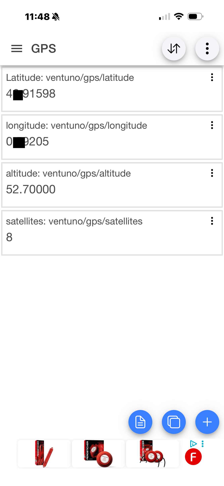

# VENTUNO Q GPS → MQTT: A Detailed Protocol and Implementation Guide

**Platform:** Arduino VENTUNO Q · **Language:** C++ (MCU sketch) · **Protocol:** MQTT 3.1.1 over TCP · **Example broker:** `broker.emqx.io:1883`

> **Project status:** Working proof of concept, tested with GPS values displayed in IoT MQTT Panel on an iPhone. This guide explains the implementation and its limits; it is not a production-ready MQTT client.

## 1. Project overview

The goal is to read NMEA sentences from a GPS receiver, extract position information on the microcontroller, and publish it directly to an MQTT broker. An MQTT subscriber, such as **IoT MQTT Panel** on a phone, displays the latest values.

```text
GPS receiver --NMEA/UART--> VENTUNO Q MCU (C++)
                               |  Parse GPS sentences
                               |  Build MQTT packets in C++
                               v
                         BridgeTCPClient<>
                               |  Network transport via the VENTUNO Q Linux side
                               v
                        TCP broker.emqx.io:1883
                               |  MQTT broker routes publications
                               v
                    IoT MQTT Panel (iPhone subscriber)
```

**Important distinction:** `BridgeTCPClient<> client(Bridge)` uses the board's bridge/network facilities to provide TCP access to the MCU. This does **not** require calling a Python `update_gps` function or forwarding GPS fields to a Python HTTP/MQTT application. The MQTT packet construction and GPS processing happen in the C++ sketch. The Linux/network infrastructure remains involved in transporting the TCP connection.

### Example topics

| Topic | Example payload | Meaning |
|---|---|---|
| `ventuno/gps/latitude` | `47.915980` | Decimal latitude |
| `ventuno/gps/longitude` | `0.792050` | Decimal longitude |
| `ventuno/gps/altitude` | `52.7` | Altitude reported by the GPS parser |
| `ventuno/gps/satellites` | `8` | Satellite count reported by the parser |

The phone subscribes to these exact topics. The example uses four separate MQTT publications, **not** a single JSON payload.




## 2. Original Project

This project is based on my earlier Arduino UNO Q GPS application:

**[UNO-Q-GPS](https://github.com/philippe86220/UNO-Q-GPS)**

The original application was developed using Arduino App Lab and combines:

- **STM32 microcontroller (MCU):** Receives GPS data through the UART interface and processes NMEA sentences.
- **Arduino Bridge:** Transfers the decoded GPS information from the MCU to the Linux environment.
- **Python:** Receives and manages the GPS data.
- **HTML WebUI Brick:** Displays the GPS information through a web interface.

### From WebUI to MQTT

The new project explores a different communication approach.

Instead of transferring GPS data to Python for display through a WebUI, the MCU publishes the decoded information directly to a remote MQTT broker using `BridgeTCPClient`.

The MQTT packets are constructed manually in C++, without relying on an external MQTT client library.

The implementation demonstrates how the MQTT 3.1.1 protocol works at the packet level, including CONNECT, CONNACK, and PUBLISH.

The Linux MPU still provides network connectivity through Arduino Bridge, but no Python-based GPS processing or HTML WebUI is required.

GPS data can then be received by any MQTT client subscribed to the corresponding topics, including the IoT MQTT Panel application on a smartphone.

For the original GPS implementation, NMEA parsing logic, and WebUI-based application, please refer to the **UNO-Q-GPS repository** linked above.

## 3. TCP is not MQTT

Two distinct operations are required:

1. **TCP connection:** `client.connect(broker, port)` establishes a byte-stream connection to the broker's TCP port.
2. **MQTT session negotiation:** the MCU sends an MQTT **CONNECT** control packet over that stream. The broker replies with **CONNACK** to accept or reject the MQTT connection.

A successful TCP connection alone does **not** mean the MQTT session has been accepted. After a successful CONNACK, the MCU can send **PUBLISH** packets.

MQTT defines the bytes and their meaning. TCP carries those bytes reliably and in order while the connection is healthy, but TCP does not itself provide MQTT session semantics or delivery acknowledgments.

## 4. The MQTT CONNECT packet: byte by byte

The proof of concept manually creates this MQTT 3.1.1 packet:

```cpp
uint8_t packet[] = {
  0x10, 0x13,
  0x00, 0x04, 'M', 'Q', 'T', 'T',
  0x04, 0x02,
  0x00, 0x3C,
  0x00, 0x07,
  'V', 'Q', 'G', 'P', 'S', '0', '1'
};
client.write(packet, sizeof(packet));
```

| Bytes | Field | Interpretation |
|---|---|---|
| `10` | Fixed-header first byte | Packet type **CONNECT** (`0001`), required low nibble `0000` |
| `13` | Remaining Length | `0x13` = **19 bytes** after the fixed header |
| `00 04` | Protocol-name length | Four bytes |
| `4D 51 54 54` | Protocol name | ASCII `MQTT` |
| `04` | Protocol level | MQTT **3.1.1** |
| `02` | Connect flags | Clean Session = 1; no Will, username, or password |
| `00 3C` | Keep Alive | `0x003C` = **60 seconds** |
| `00 07` | Client ID length | Seven bytes |
| `56 51 47 50 53 30 31` | Client ID | ASCII `VQGPS01` |

**Length verification:** variable header = 10 bytes; payload = 2 + 7 = 9 bytes; Remaining Length = 19; fixed header = 2 bytes; **total packet = 21 bytes**.

### CONNECT is not a constant packet

The example's bytes are valid **for these specific settings**. Changing the client ID, Keep Alive, flags, or optional fields changes the packet. For example, changing the Client ID from `VQGPS01` (7 bytes) to `GPS01` (5 bytes) requires updating the Client ID length from `00 07` to `00 05`, and Remaining Length from `13` to `11` (hexadecimal).

A declared C++ variable such as `const char* clientId = "VQGPS01";` does **not** affect this particular packet if the identifier is hard-coded in the array. Either change the literal bytes consistently or build the packet dynamically.

### Clean Session and Keep Alive

- **Clean Session = 1** requests a new, nonpersistent session in MQTT 3.1.1.
- **Keep Alive = 60 seconds** sets the maximum interval between MQTT Control Packets sent by the client while the connection is maintained. If no other packet is due, a complete client should send **PINGREQ** and process **PINGRESP**. The broker may close the connection after approximately 1.5 times the Keep Alive interval without receiving a control packet.
- Publishing every five seconds normally keeps the connection active, but a GPS outage or a long pause can expose the lack of ping handling in this proof of concept.

## 5. The broker's CONNACK response

For MQTT 3.1.1, CONNACK has **four bytes**:

```text
20 02 00 00
│  │  │  └── Return Code: 0 = connection accepted
│  │  └───── Connect Acknowledge Flags: Session Present = 0
│  └──────── Remaining Length: 2
└─────────── Packet type: CONNACK
```

The sketch waits for at least four readable bytes, with a timeout, and then checks the expected success response:

```cpp
unsigned long start = millis();
while (client.available() < 4 && millis() - start < 5000) {
  delay(10);
}
if (client.available() < 4) {
  Serial.println("No CONNACK received");
  client.stop();
  return false;
}
uint8_t response[4];
for (int i = 0; i < 4; i++) response[i] = client.read();
if (response[0] != 0x20 || response[1] != 0x02 ||
    response[2] != 0x00 || response[3] != 0x00) {
  Serial.println("MQTT connection rejected");
  client.stop();
  return false;
}
return true;
```

| CONNACK return code | Meaning in MQTT 3.1.1 |
|---|---|
| `0x00` | Connection accepted |
| `0x01` | Unacceptable protocol version |
| `0x02` | Identifier rejected |
| `0x03` | Server unavailable |
| `0x04` | Bad username or password |
| `0x05` | Not authorized |

**Protocol nuance:** the Session Present bit can be 1 for a resumed persistent session, but it should be 0 for a successful Clean Session = 1 connection. The code above checks the exact four-byte success response appropriate to this project. TCP is a byte stream: receiving four bytes does not imply four separate network packets, and a robust client should also handle timeouts, partial writes, unexpected data, and connection closure.

## 6. The PUBLISH function, explained line by line

The MCU uses this minimal MQTT 3.1.1 QoS 0 publisher:

```cpp
void mqttPublish(const char* topic, const char* message) {
  uint16_t topicLength = strlen(topic);
  uint16_t messageLength = strlen(message);

  uint16_t remainingLength = 2 + topicLength + messageLength;
  if (remainingLength > 127) {
    Serial.println("MQTT message too long");
    return;
  }

  client.write((uint8_t)0x30);
  client.write((uint8_t)remainingLength);

  client.write((uint8_t)(topicLength >> 8));
  client.write((uint8_t)(topicLength & 0xFF));

  client.write((const uint8_t*)topic, topicLength);
  client.write((const uint8_t*)message, messageLength);
}
```

### 6.1 Topic and payload lengths

`strlen()` counts bytes in the ASCII example strings, **excluding** the terminating `\0` byte. MQTT sends the topic name and payload without C string terminators.

For this example:

```cpp
mqttPublish("ventuno/gps/latitude", "46.91598");
```

- Topic `ventuno/gps/latitude`: **20 bytes**.
- Payload `46.91598`: **8 bytes**.
- Topic-length field: **2 bytes**.
- Remaining Length = `2 + 20 + 8 = 30` bytes = **`0x1E`**.

The Remaining Length counts all bytes **after** the fixed header. It includes the two-byte topic length, the topic itself, and the payload. With QoS 0, there is no Packet Identifier field.

### 6.2 First fixed-header byte: `0x30`

```cpp
client.write((uint8_t)0x30);
```

`0x30` = binary `0011 0000`:

```text
0011 0000
^^^^      MQTT packet type 3 = PUBLISH
    ^     DUP = 0
     ^^   QoS = 00 (QoS 0)
       ^  RETAIN = 0
```

**QoS 0** is “at most once”: the MQTT protocol does not provide a PUBLISH acknowledgment for this message. If the connection fails or the message is lost, the application does not know whether subscribers received it. This is often acceptable for frequently refreshed GPS readings.

**RETAIN = 0** means the broker is not asked to save this publication as the last retained message for future subscribers. A phone that subscribes later normally waits for the next update.

### 6.3 Remaining Length: `0x1E`

```cpp
client.write((uint8_t)remainingLength);
```

MQTT's Remaining Length uses a **variable-length encoding**, potentially 1–4 bytes. For values from 0 to 127, it occupies exactly one byte, so `0x1E` is correct for our example. This minimal function rejects values greater than 127 instead of implementing the general encoding.

### 6.4 Two-byte topic length: `00 14`

```cpp
client.write((uint8_t)(topicLength >> 8));
client.write((uint8_t)(topicLength & 0xFF));
```

Twenty decimal = `0x0014`. MQTT's two-byte integer is encoded **most-significant byte first** (big-endian / network byte order):

- `topicLength >> 8` extracts the high byte: `0x00`.
- `topicLength & 0xFF` extracts the low byte: `0x14`.

The broker reads `00 14` and knows the next **20 bytes** are the topic name. This two-byte length is not the same thing as the Remaining Length field.

### 6.5 Topic and payload bytes

```cpp
client.write((const uint8_t*)topic, topicLength);
client.write((const uint8_t*)message, messageLength);
```

These calls send the raw bytes of the topic followed by the raw bytes of the payload. The casts allow the `const char*` data to be passed to the byte-buffer overload of `write()`; the explicit lengths prevent sending the terminating `\0`.

MQTT topic names are UTF-8 strings. In this project, the topic names and numeric payloads use simple ASCII characters, which are also valid UTF-8.

### 6.6 Complete PUBLISH packet

```text
Hex prefix: 30 1E 00 14
ASCII topic: ventuno/gps/latitude
ASCII payload: 46.91598
```

| Part | Length |
|---|---:|
| Fixed header: `30 1E` | 2 bytes |
| Topic length: `00 14` | 2 bytes |
| Topic: `ventuno/gps/latitude` | 20 bytes |
| Payload: `46.91598` | 8 bytes |
| **Total** | **32 bytes** |

The broker parses the PUBLISH packet and routes its payload to clients subscribed to matching topics. The broker does not need to know that the number represents latitude; that meaning is established by the application and topic name.

## 7. When does the sketch reconnect or publish?

The relevant control flow is:

```cpp
void setup() {
  Serial.begin(9600);
  Serial1.begin(9600);
  if (!Bridge.begin()) while (true) {}
  mqttConnect();
}

void loop() {
  if (getSentence()) gps.setSentence(sentence);

  if (gps.extrait() && gps.estValide()) {
    if (millis() - lastPublish >= publishInterval) {
      lastPublish = millis();

      if (!client.connected()) {
        if (!mqttConnect()) return;
      }

      // Format and publish the four GPS fields here.
    }
  }
}
```

The intended behavior is:

1. `setup()` initializes the serial ports and bridge, then attempts the first MQTT connection.
2. `loop()` repeatedly reads and processes GPS sentences.
3. When valid GPS data is available and at least **5 seconds** have passed since the previous publication attempt, the sketch checks the TCP connection.
4. **If still connected**, it does **not** resend MQTT CONNECT; it publishes the GPS values.
5. **If disconnected**, it attempts TCP + MQTT CONNECT and waits for a successful CONNACK before publishing.
6. If reconnection fails, `return;` exits **only the current `loop()` invocation**. Arduino calls `loop()` again. Because `lastPublish` was already updated, another attempt normally waits for the next interval and valid GPS data.

**Subtlety:** `client.connected()` reports the TCP connection state; it does not by itself prove that the MQTT session is still accepted. The simple sketch does not implement a complete MQTT session state machine.

## 8. Converting GPS values into MQTT payloads

After parsing a valid NMEA sentence, the sketch formats values as text:

```cpp
char buffer[32];

snprintf(buffer, sizeof(buffer), "%.6f", gps.latitude);
mqttPublish("ventuno/gps/latitude", buffer);

snprintf(buffer, sizeof(buffer), "%.6f", gps.longitude);
mqttPublish("ventuno/gps/longitude", buffer);

snprintf(buffer, sizeof(buffer), "%.1f", gps.altitude);
mqttPublish("ventuno/gps/altitude", buffer);

snprintf(buffer, sizeof(buffer), "%d", gps.numSat);
mqttPublish("ventuno/gps/satellites", buffer);
```

- `%.6f` formats latitude/longitude to six decimal places.
- `%.1f` formats altitude to one decimal place.
- `%d` formats the satellite count as a decimal integer.
- `snprintf()` limits the number of bytes written to the local buffer.

Each `mqttPublish()` call creates a **separate** MQTT PUBLISH packet. The four fields are not delivered atomically; a subscriber could briefly display values from different updates.

## 9. Why the example needs no MQTT library

The application builds the protocol packets directly using `client.write()`. This makes the wire format transparent and is excellent for learning. However, a mature MQTT client library normally handles:

- Variable-length Remaining Length encoding.
- Connection negotiation and protocol errors.
- Keep Alive with PINGREQ/PINGRESP.
- Partial writes, disconnects, and reconnection state.
- QoS 1/2 acknowledgments and retransmission rules.
- Optional authentication, TLS transport, subscriptions, and other features.

This proof of concept implements only the subset needed to send short, periodic **QoS 0** GPS messages.

## 10. Practical limitations and improvements

| Area | Current implementation | Recommended improvement for long-term use |
|---|---|---|
| Keep Alive | Set to 60 s; no explicit PINGREQ | Implement PINGREQ/PINGRESP when idle |
| MQTT Remaining Length | One byte, maximum 127 | Encode full MQTT variable-length integer |
| Publishing | QoS 0, no broker acknowledgment | Keep QoS 0 for telemetry or add QoS 1 with packet IDs and PUBACK |
| Writes | Return values from `write()` not checked | Verify all bytes are accepted and handle partial writes/errors |
| Reconnect | Only checked when publishing valid GPS data | Track connection state and retry independently of GPS availability |
| Session state | `connected()` checks TCP | Track MQTT connection and ping responses explicitly |
| Client ID | Hard-coded `VQGPS01` in CONNECT bytes | Generate/configure a unique Client ID and build lengths dynamically |
| Security | Public TCP port 1883, no encryption | Use authenticated, TLS-protected MQTT where supported |
| Topic naming | Shared public namespace | Choose a unique topic prefix and avoid publishing sensitive locations |
| GPS validity | Depends on custom `Trame` parser | Document which NMEA sentence types and validity checks are supported |

### Public-broker privacy warning

`broker.emqx.io` is a public test broker. Topics are **not private**, and unencrypted port 1883 traffic is not protected by TLS. Other users may subscribe to or publish on the same topic names. Publishing real GPS coordinates can disclose a location. Use test data, a suitably anonymized location, or a private authenticated broker for anything sensitive. Public brokers are not appropriate for dependable production telemetry.

### Client-ID collisions

MQTT Client IDs must identify client connections uniquely on the broker. If another client connects with the same Client ID, the broker may disconnect the existing connection. The hard-coded `VQGPS01` is a learning example, not a robust globally unique identifier.

## 11. Testing the pipeline

### Test a subscriber without the GPS sketch

On a Linux system with Mosquitto command-line utilities:

```bash
mosquitto_pub -h broker.emqx.io -p 1883 \
  -t "ventuno/gps/latitude" -m "46.91597"
```

Or subscribe from a terminal:

```bash
mosquitto_sub -h broker.emqx.io -p 1883 -v -t 'ventuno/gps/#'
```

This verifies broker access and topic routing independently of the GPS parser and MCU implementation. It does **not** test whether the MCU successfully builds CONNECT/PUBLISH packets.

### IoT MQTT Panel configuration

- Broker host: `broker.emqx.io`
- TCP port: `1883`
- MQTT client ID: unique for the phone application
- Dashboard: `GPS`
- Widgets: text outputs subscribed to the four topics listed in section 1
- If the app automatically prefixes topics with a dashboard prefix, disable that behavior or configure the final topic strings accordingly.

## 12. Project files and responsibilities

A typical Arduino App Lab project separates these concerns:

```text
project/
├── sketch.ino   # UART/NMEA acquisition, GPS parsing, MQTT CONNECT/PUBLISH
├── trame.h      # Custom GPS sentence parser used by the sketch
└── main.py      # App Lab-side application entry point, if required by project setup
```

The C++ sketch depends on the Arduino RouterBridge facilities and on the project's custom `Trame` parser. This guide documents the protocol but is **not** a self-contained buildable project without those dependencies. A minimal Python entry point may still be present for App Lab's application lifecycle; no Python GPS-processing or MQTT-publishing function is required by this design. Python stdout and MCU serial output are separate logging streams.

## 13. Quick protocol reference

| Packet | Direction | Purpose | Example bytes |
|---|---|---|---|
| CONNECT | MCU → broker | Request MQTT session | Starts `10 13 ...` |
| CONNACK | Broker → MCU | Accept/reject session | `20 02 00 00` = accepted |
| PUBLISH | MCU → broker | Send topic + payload | Starts `30 1E ...` for example |
| PINGREQ | MCU → broker | Keep an idle session alive | `C0 00` (not implemented) |
| PINGRESP | Broker → MCU | Reply to PINGREQ | `D0 00` (not implemented) |
| DISCONNECT | MCU → broker | Graceful session termination | `E0 00` (not implemented) |

**Key takeaway:** **TCP carries bytes; MQTT defines what those bytes mean.** The MCU establishes TCP, sends CONNECT, validates CONNACK, and then sends PUBLISH packets containing GPS topic/payload pairs. The bridge supplies the network transport; the MQTT logic itself is implemented in C++.

## 14. References

- OASIS, *MQTT Version 3.1.1* — normative specification: https://docs.oasis-open.org/mqtt/mqtt/v3.1.1/os/mqtt-v3.1.1-os.html
- EMQX public MQTT broker information: https://www.emqx.com/en/mqtt/public-mqtt5-broker
- Arduino documentation portal: https://docs.arduino.cc/

## Acknowledgements

This project was developed by Philippe Costes with the assistance of OpenAI's ChatGPT (GPT-6), particularly for the MQTT protocol implementation, code analysis, debugging, and technical documentation.

The implementation was tested and validated on an Arduino VENTUNO Q.

---

*Prepared for the VENTUNO Q GPS/MQTT proof of concept, November 2026. Example measurements and packet lengths are illustrative and based on the project's demonstrated configuration.*
